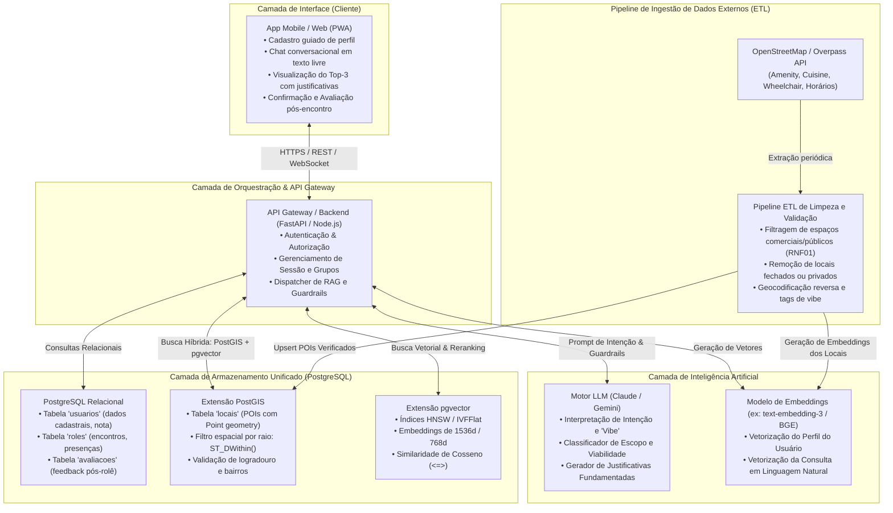

# Diagramas de Arquitetura e Pipeline do Sistema

Este documento apresenta a especificação técnica e visual da arquitetura de software e do pipeline de dados e usuário do projeto **Bubblues (Combate à Solidão via Encontros Presenciais em Locais Públicos Verificados)**.

Conforme decisão de engenharia e corte de escopo, **o modelo de clusterização em lote não-supervisionada (clustering estático) foi completamente removido** da pipeline e substituído por uma **arquitetura RAG de Recuperação Vetorial Híbrida em Tempo Real** combinando `pgvector` e `PostGIS`.

---

## 1. Diagrama de Arquitetura do Sistema

A arquitetura adota uma abordagem modular baseada em serviços leves e banco de dados relacional enriquecido com suporte geoespacial e vetorial unificado no PostgreSQL.

---

## 2. Diagrama de Pipeline de Dados e Fluxo do Usuário

Este diagrama reflete o fluxo completo do usuário do cadastro até a avaliação pós-encontro, **com a remoção explícita da menção e dependência de "clusters"**, operando via matching semântico vetorial sob demanda.

```mermaid
flowchart TD
    %% Nós do Fluxo de Cadastro
    U([Usuário]) --> CAD["1. Cadastro na Plataforma<br>• Dados básicos do usuário<br>• Perguntas de perfil psicossocial<br>(gostos, hobbies, sociabilidade)"]
    CAD --> VEC_USR["2. Vetorização do Perfil<br>• Geração de embedding do usuário<br>• Upsert no PostgreSQL + pgvector"]

    %% Bifurcação de Escolha
    VEC_USR --> CHOOSE{"Tipo de Interação?"}

    %% Fluxo Sem Escolha (Recomendação Passiva)
    CHOOSE -->|Sugestões Pré-definidas| PASSIVE["3A. Busca por Perfil Base<br>• Consulta semântica pgvector (embedding usuário)<br>• Filtro PostGIS por raio de distância<br>• Score composto (0.4*Google + 0.6*App)"]
    PASSIVE --> CARDS["Recomendações com base na afinidade geral"]

    %% Fluxo Com Escolha (Linguagem Natural)
    CHOOSE -->|Texto Livre / Desejo Pontual| ACTIVE["3B. Ideia em Linguagem Natural<br>Ex: 'Quero um café tranquilo na Asa Sul<br>para conversar sobre livros'"]
    ACTIVE --> NLU["4. Interpretação LLM & Guardrails<br>• Extração de entidades (atividade, vibe, horário)<br>• Validação de Escopo & Viabilidade<br>• Detecção de Ambiguidades"]

    %% Guardrail Branch
    NLU --> CHECK_SCOPE{"Validação de Escopo?"}
    CHECK_SCOPE -->|Fora de Escopo / Impossível| ABSTAIN["Abstenção Transparente & Segura<br>• Recusa educada de fretes/serviços<br>• Notificação de filtros sem resultado<br>• Sugestão amigável de ajuste"]
    
    CHECK_SCOPE -->|Pedido Válido| RAG_SEARCH["5. Recuperação Híbrida (RAG)<br>• SELECT PostGIS: ST_DWithin(local, user_pt, raio)<br>• SELECT pgvector: Cosine_Distance(query_vec, poi_vec)<br>• Validação RNF01: is_public_verified = TRUE"]
    
    RAG_SEARCH --> RERANK["6. Reranking Multi-Fatorial<br>• Score = w_v*Vetorial + w_d*Distancia +<br>  w_r*Reputacao + w_c*Compatibilidade"]

    RERANK --> TOP3["7. Apresentação do Top-3 com Justificativa<br>• Opção 1: Alinhamento ótimo<br>• Opção 2: Alternativa equilibrada<br>• Opção 3: Sugestão para experimentar"]

    %% Convergência e Formação de Grupo
    CARDS --> SELECT_ROLE["8. Usuário Escolhe a Opção"]
    TOP3 --> SELECT_ROLE
    
    SELECT_ROLE --> GROUP_ASSIGN["9. Alocação em Grupo Compatível<br>• Grupo pequeno (3 a 4 pessoas desconhecidas)<br>• Detalhes do rolê (local público, data, horário)"]

    %% Confirmação e Presença
    GROUP_ASSIGN --> NOTIF_24["Notificação 24h antes"]
    NOTIF_24 --> NOTIF_2["Notificação 2h antes"]
    NOTIF_2 --> CONFIRM["10. Confirmação Final de Presença<br>(30 a 60 min antes do evento)<br>• Quórum mínimo: metade + 1 confirmado"]

    CONFIRM --> MEET["11. Realização do Encontro Presencial<br>em Espaço Público Verificado"]

    %% Avaliação Pós-Rolê
    MEET --> FEEDBACK["12. Avaliação Pós-Rolê (Feedback)<br>• Presença efetiva (combate ao no-show)<br>• Avaliação da adequação do local (1 a 5)<br>• Satisfação com o grupo e segurança"]

    FEEDBACK --> RETRO["13. Retroalimentação da Base<br>• Atualização da nota ponderada do local<br>• Ajuste de reputação do usuário<br>• Atualização de histórico no PostgreSQL"]
```

---

## 3. Principais Mudanças em Relação ao Rascunho Anterior

1. **Eliminação do "Clustering com base no embedding":**
   - O rascunho anterior dependia de uma etapa síncrona ou em lote de clusterização de usuários para habilitar sugestões personalizadas, gerando *race conditions* descritas pela própria equipe no fluxo original.
   - **Solução implementada:** O sistema adota consultas vetoriais dinâmicas no `pgvector` indexadas via HNSW, calculando distâncias semânticas sob demanda sem necessidade de re-clusterizar toda a base a cada novo usuário.
2. **Integração Nativa de Guardrails e Abstenção:**
   - Adicionada a camada de verificação semântica de escopo e viabilidade antes da busca no banco, garantindo que solicitações impossíveis ou fora de escopo sejam tratadas com abstenção transparente (100% de acerto no benchmark).
3. **Fórmula de Score Consolidada:**
   - A pontuação de reputação agora combina a avaliação histórica comunitária e externa:
     $$\text{Score}_{\text{reputação}} = 0.4 \times \text{Google} + 0.6 \times \text{Usuários App}$$
   - Ponderada conjuntamente com a similaridade semântica vetorial ($w_v = 0.40$), proximidade física ($w_d = 0.25$) e compatibilidade de ambiente ($w_c = 0.20$).

