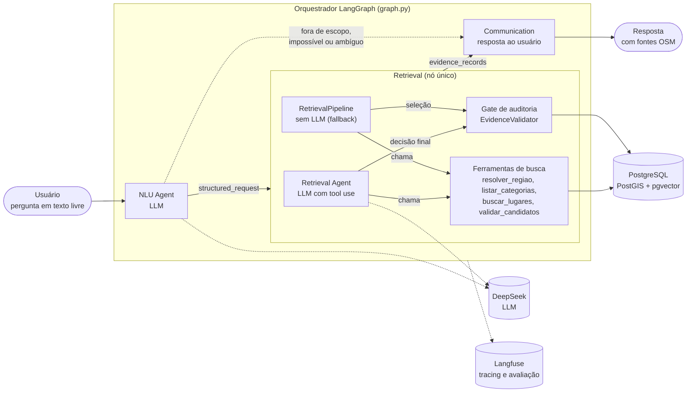
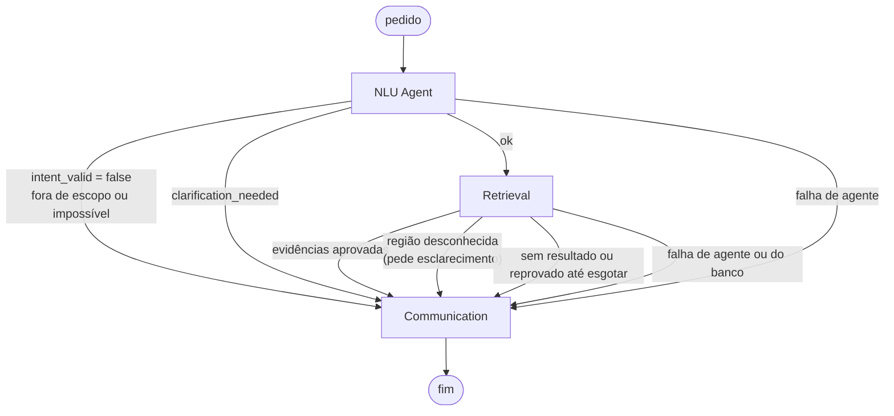
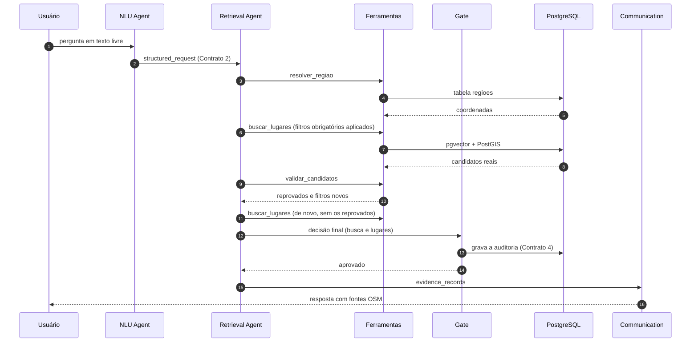

# Arquitetura dos agentes do Bubbles

Este documento descreve **quem faz o quê**, **como os componentes colaboram** e **quais garantias o sistema dá**. A execução real de um fluxo completo está em [`demo_fluxo_completo.md`](demo_fluxo_completo.md).

## 1. Visão geral

O Bubbles recebe um pedido em português ("quero um café calmo e acessível na Asa Sul") e devolve **lugares públicos reais do Distrito Federal**, cada um com a prova de onde veio (OpenStreetMap) e uma auditoria. Um orquestrador **LangGraph** coordena três etapas:

> **NLU** (entende o pedido) → **Retrieval** (busca e audita) → **Communication** (responde ao usuário)

**Convenção de nomes.** Chamamos de **agente** só o que usa um LLM e decide por conta própria. O que é determinístico é **ferramenta**, **gate** ou **pipeline**:

| Tipo | Usa LLM? | Exemplos |
|---|---|---|
| **Agente** | sim | NLU Agent; Retrieval Agent |
| **Ferramenta** | não | `resolver_regiao`, `listar_categorias`, `buscar_lugares`, `validar_candidatos` |
| **Gate** | não | `RetrievalGate` (auditoria obrigatória) |
| **Pipeline** | não | `RetrievalPipeline` (o Retrieval sem LLM; também é o fallback do agente) |

## 2. Diagrama da arquitetura

**Legenda:** setas contínuas são o fluxo de dados; tracejadas são dependências externas ou desvios. O Retrieval é **um único nó** do grafo: o laço de busca, auditoria e reconsulta acontece dentro dele.

**No PostgreSQL:** `places` (4.527 lugares do OSM com embedding), `regioes` (RAs, bairros e quadras, para converter "Asa Sul" em coordenadas), `evidencias_busca` (uma linha por busca) e `evidencias_auditoria` (uma linha por candidato auditado, o Contrato 4).

## 3. Responsabilidades de cada componente

### NLU Agent (LLM) · `nlu_agent.py`
- **Faz:** transforma o texto livre em um `structured_request` (Contrato 2): atividade, categorias, clima, tolerância a ruído, região e raio, horário, acessibilidade.
- **Decide sozinho:** se o pedido é **fora de escopo** (ex.: frete), **impossível** (ex.: "Narnia") ou **ambíguo** (devolve uma pergunta de esclarecimento).
- **Não pode:** inventar categorias (só as que existem em `places.categoria`), nem devolver JSON fora do contrato (o Pydantic valida; se falhar, o modelo recebe o motivo e tenta de novo, até 3 tentativas). O texto livre é **descartado** depois (RNF02).

### Retrieval Agent (LLM com tool use) · `retrieval_agent.py`
- **Faz:** decide a estratégia de busca: resolve a região, escolhe categorias, reformula a consulta semântica, valida, busca de novo se os resultados forem fracos, e encerra com um JSON `{busca_escolhida, place_ids?}`.
- **Limites:** até 6 passos de LLM, 4 buscas, 2 reconsultas e 60 s. Qualquer falha cai no `RetrievalPipeline`.
- **Não pode:** escrever resultado. `search_response` e `evidence_records` saem do banco e do gate; um lugar que não veio de uma busca da execução é recusado.

### Ferramentas de busca · `retrieval_tools.py`
| Ferramenta | O que faz |
|---|---|
| `resolver_regiao(nome)` | candidatos da tabela `regioes`, com coordenadas |
| `listar_categorias()` | categorias válidas e quantos lugares há em cada |
| `buscar_lugares(...)` | busca por similaridade semântica (pgvector) e distância (PostGIS) |
| `validar_candidatos(busca_id)` | audita uma busca já feita; reprovados e filtros novos valem nas próximas buscas |

Os **filtros obrigatórios** (acessibilidade, ruído, lugares já reprovados) são aplicados **dentro** de `buscar_lugares`; não existe argumento para desligá-los. Raio, `k`, categorias e coordenadas (precisam estar no DF) são limitados e validados.

### Gate de auditoria + EvidenceValidator · `retrieval_gate.py`, `validation_tool.py`
- **Faz (sem LLM):** audita o que vai ser entregue: **RNF01** (existe no OpenStreetMap e é público), **restrições** (cadeira de rodas, ruído, idosos, **horário de funcionamento**) e **integridade matemática** do score (a soma das contribuições bate com o total).
- **É obrigatório:** roda mesmo que o agente nunca chame `validar_candidatos`. Grava a auditoria no PostgreSQL; **se a gravação falhar, nada é entregue** (fail-closed).
- **Devolve:** `validation_feedback` (aprovado, reprovados, filtros novos, diagnóstico) e os `evidence_records` (Contrato 4).

### RetrievalPipeline (sem LLM) · `retrieval_pipeline.py`
- **Faz** a mesma coisa que o agente, mas de forma fixa: região → busca → gate → reconsulta com os filtros do feedback (até 2 vezes). É o **padrão** (`RETRIEVAL_MODE=deterministic`) e o **fallback** do agente.

### Communication · `stubs.py` (hoje)
- **Faz:** monta a resposta final a partir de `evidence_records` (ou a pergunta de esclarecimento, ou a abstenção).
- **Estado atual:** no grafo padrão ainda é um **stub**. O PR #15 traz um formatador determinístico (`communication.py`) compatível com o nosso estado; **um Communication com LLM ainda não existe**. Os guardrails que ele deve respeitar: usar só dados dos `evidence_records` e citar a fonte OSM.

### Orquestrador · `graph.py`
- **Faz:** passa o estado entre os nós, decide o próximo (`route_after_nlu`, `route_after_retrieval`), valida cada contrato com Pydantic e registra o `agent_trace` (para onde foi e por quê). Uma falha de qualquer nó vira **abstenção segura**, sem vazar texto do usuário.

## 4. Contratos entre os componentes

| Contrato | Quem produz | Quem consome | Conteúdo |
|---|---|---|---|
| **2** `structured_request` | NLU | Retrieval, Communication | o pedido entendido |
| **3** `search_response` | Retrieval (tools) | Gate | itens com score decomposto e **metadados do OSM** (`osm_id`, `osm_tags`...) |
| **4** `evidence_record` | Gate | Communication, banco | lugar, link do OSM, fatores do score, teste de integridade, notas de fundamentação |
| `validation_feedback` | Gate | Retrieval | aprovado?, `rejected_place_ids`, `hard_filters`, diagnóstico |

## 5. Fluxo de interação e colaboração

### 5.1 Rotas do grafo

### 5.2 Colaboração por dentro do Retrieval (caminho típico, com autocorreção)

### 5.3 O que acontece quando algo dá errado

| Situação | O que o sistema faz |
|---|---|
| Pedido fora de escopo, impossível ou ambíguo | o NLU decide; o grafo pula a busca e vai ao Communication |
| Região que não existe na base | pede esclarecimento, **sem buscar em lugar nenhum** |
| O modelo tenta passar um filtro de acessibilidade como argumento | a tool **recusa** a chamada; os filtros não se desligam |
| O modelo cita um lugar que não veio da busca | o gate recusa; o modelo corrige ou usa `busca_escolhida: null` |
| O gate reprova a escolha | o diagnóstico volta ao modelo; ele busca de novo (até 2 vezes) |
| Reprovou até esgotar, passos esgotados ou LLM fora do ar | **fallback**: o `RetrievalPipeline` assume |
| Sem candidatos | abstenção |
| Banco fora do ar ou falha ao gravar a auditoria | abstenção segura (nada é entregue sem rastro de auditoria) |

## 6. Garantias

- **RNF01 (zero alucinação):** todo lugar entregue existe no OpenStreetMap (`osm_id` e `osm_type`), é público e passou na auditoria; o que o texto final afirma vem dos `evidence_records`.
- **RNF02 (privacidade):** o texto livre é descartado após o NLU; não vai para o estado, para a nota do Retrieval, para o banco nem para os traces do Langfuse (por padrão não se grava o conteúdo das mensagens ao LLM).
- **Acessibilidade segura (ADR-0002):** quando exigida, só passa quem tem `wheelchair=yes` **explícito** no OSM (cerca de 3,7% dos lugares).
- **Rastreabilidade:** `evidencias_busca` (a busca) e `evidencias_auditoria` (cada candidato auditado) se ligam por `consulta_id`; o `agent_trace` explica cada transição do grafo.

## 7. Configuração

| Variável | Efeito |
|---|---|
| `RETRIEVAL_MODE` | `deterministic` (padrão, sem LLM) ou `llm` (agente, com fallback) |
| `DEEPSEEK_API_KEY`, `DEEPSEEK_MODEL`, `DEEPSEEK_REASONING_EFFORT`, `DEEPSEEK_STRICT` | o LLM (padrão: `deepseek-flash`, sem thinking) |
| `LANGFUSE_PUBLIC_KEY`, `LANGFUSE_SECRET_KEY`, `LANGFUSE_BASE_URL` | liga o tracing e os experimentos |
| `LANGFUSE_LOG_CONTENT` | só depuração: grava o conteúdo das mensagens ao LLM |

Os nomes estão em `.env.example`. **Os valores nunca vão para o repositório.**

## 8. Avaliação: o agente vale o custo?

Na avaliação formal (`docs/avaliacao/fase_f_resultados.md`, 15 casos, 3 repetições), o agente LLM ficou **equivalente ao pipeline em quase tudo**; o ganho vem de um caso que o embedding não resolve (um pedido de "cinema com cafeteria"). Custa ~4 s e ~9,5 mil tokens por pedido, contra 0,1 s do pipeline. Por isso o padrão continua sendo `deterministic`.

## 9. Limitações conhecidas

- O **Communication ainda não usa LLM** e, no grafo padrão, é um stub.
- O **NLU com LLM existe, mas não está plugado no grafo padrão** (os scripts de avaliação injetam o `structured_request`).
- Quando a busca **amplia o raio sozinha** (até 2x), o usuário **não é avisado** na resposta.
- Quando o horário **não está no OSM** (só ~10% dos lugares têm), a resposta não diz que o pedido de horário **não foi confirmado**.
- Só ~3,7% dos lugares têm `wheelchair=yes`, e nenhum tem `noise_level`: a busca acessível devolve poucas opções.
- Região administrativa inteira (ex.: "Plano Piloto") usa o centro da caixa da relação OSM, que pode ficar longe do que o usuário imagina.
