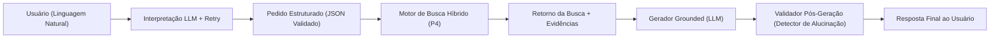
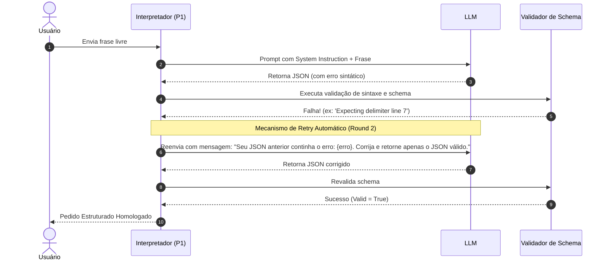

# Pacote 1 (P1): Contratos, LLM e Demonstração
**Projeto:** Bubbles — Encontros Presenciais Seguros para Combate à Solidão  
**Programa:** Residência em Inteligência Artificial (TIC-IA) — Grupo 10  
**Responsável pelo Pacote:** Entrega P1  
**Status:** 100% Concluído e Validado  

---

## Sumário Executivo do Pacote 1 (P1)

O **Pacote 1 (P1)** estabelece a fundação de contratos de dados, engenharia de prompts, guardrails e resiliência conversacional da plataforma **Bubbles**. Ele conecta o usuário final (que se expressa em linguagem natural livre) aos motores internos de dados geoespaciais e busca vetorial (P2/P3/P4), garantindo **zero alucinação** e respostas 100% ancoradas em evidências auditáveis.



### Critério de Conclusão ("Pronto Quando")
> **"Pronto quando: um pedido vira JSON e a resposta cita apenas locais recuperados."**  
> **Status:** **HOMOLOGADO (100% de conformidade)** nos três cenários de teste (válido, impossível e fora de escopo), com validação de esquema, retry funcional e verificação automática pós-geração.

---

## 1. Definição Formal dos Quatro Formatos (Contratos de Dados)

Para assegurar o desacoplamento entre módulos e garantir a integridade entre ingestão, vetorização, busca e resposta, foram definidos quatro contratos rígidos.

### 1.1. Formato 1: Registro de Local (`place_record`)
Representa o registro atômico de um estabelecimento ou espaço público proveniente da curadoria OpenStreetMap / PostGIS (produzido em P2 e enriquecido em P3/P4).

| Campo | Tipo | Obrigatório | Descrição |
|---|---|:---:|---|
| `place_id` | `string` | Sim | Identificador único do local no sistema (ex: `"POI-01"` ou `"osm:node:482910482"`). |
| `name` | `string` | Sim | Nome oficial do estabelecimento ou logradouro público. |
| `amenity` | `string` | Sim | Tag primária de amenidade do OSM (ex: `"cafe"`, `"park"`, `"library"`). |
| `category` | `string` | Sim | Categoria refinada de curadoria (ex: `"cafe_especial"`, `"parque_urbano"`). |
| `address` | `string` | Sim | Endereço formatado e padronizado em Brasília (ex: `"CLS 115 Bloco C, Asa Sul"`). |
| `location` | `object` | Sim | Coordenadas geodésicas (`lat`: float, `lon`: float). |
| `is_public_verified` | `boolean` | Sim | **Guardrail de Segurança (RNF01):** Deve ser estritamente `true` para ser elegível a encontros. |
| `opening_hours` | `string` | Não | Horário de funcionamento formatado (ex: `"07:00-20:00"`). |
| `wheelchair` | `enum` | Não | Acessibilidade física: `"yes"`, `"limited"`, `"no"`, `"unknown"`. |
| `noise_level` | `enum` | Não | Nível acústico aferido: `"baixo"`, `"moderado"`, `"alto"`. |
| `vibe` | `string` | Não | Atmosfera predominante: `"tranquilo"`, `"ar_livre"`, `"cultural"`. |
| `ratings` | `object` | Não | Avaliações consolidadas: `{ google_rating, app_rating, total_reviews }`. |
| `tags` | `list[string]` | Sim | Lista de etiquetas padronizadas para matching categórico. |
| `vector` | `list[float]` | Sim | Vetor semântico denso normalizado (16 dimensões do P3). |
| `provenance` | `object` | Sim | Metadados de proveniência OSM: `{ source, osm_id, osm_type, osm_link, ingestion_date }`. |

#### Exemplo em JSON:
```json
{
  "place_id": "POI-01",
  "name": "Ernesto Cafés Especiais",
  "amenity": "cafe",
  "category": "cafe_especial",
  "address": "CLS 115 Bloco C, Asa Sul, Brasília - DF",
  "location": { "lat": -15.8234, "lon": -47.9256 },
  "is_public_verified": true,
  "opening_hours": "07:00-20:00",
  "wheelchair": "yes",
  "noise_level": "baixo",
  "vibe": "tranquilo",
  "suitable_for": ["introvertido", "idosos", "adulto", "conversas_profundas"],
  "ratings": {
    "google_rating": 4.7,
    "app_rating": 4.8,
    "total_reviews": 1240
  },
  "tags": ["cafe", "calmo", "acessivel", "leitura", "conversa", "brunch", "asa sul"],
  "vector": [0.9, 0.1, 0.3, 0.4, 0.6, 0.0, 0.9, 0.1, 0.2, 0.4, 0.8, 0.0, 0.5, 0.0, 0.0, 0.6],
  "provenance": {
    "source": "OpenStreetMap",
    "osm_id": 482910482,
    "osm_type": "node",
    "osm_link": "https://www.openstreetmap.org/node/482910482",
    "ingestion_date": "2026-11-01T08:00:00Z"
  }
}
```

---

### 1.2. Formato 2: Pedido Estruturado (`structured_request`)
Contrato emitido pela LLM na etapa de NLU ao interpretar o desejo livre do usuário. Extrai entidades, restrições e aciona guardrails de escopo.

| Campo | Tipo | Obrigatório | Descrição |
|---|---|:---:|---|
| `request_id` | `string` | Sim | Identificador único da requisição (UUID). |
| `raw_query` | `string` | Sim | Texto original enviado pelo usuário. |
| `intent_valid` | `boolean` | Sim | `false` se o pedido for fora de escopo ou impossível; `true` para seguir com a busca. |
| `out_of_scope` | `boolean` | Sim | `true` se solicitar frete, mudanças, comércio ilegal, caronas ou serviços externos. |
| `out_of_scope_reason` | `string/null` | Não | Justificativa transparente quando `out_of_scope` for `true`. |
| `impossible_criteria` | `boolean` | Sim | `true` se os critérios forem contraditórios ou inexistentes (ex: patinação no gelo às 3h30 da manhã). |
| `impossible_criteria_reason`| `string/null` | Não | Motivo da impossibilidade física/temporal. |
| `activity` | `string` | Sim | Atividade social pretendida (ex: `"leitura compartilhada"`, `"caminhada"`). |
| `target_amenities` | `list[string]` | Sim | Tipos de POIs desejados (ex: `["cafe", "library"]`). |
| `vibe` | `string` | Sim | Atmosfera solicitada (ex: `"tranquilo"`, `"ar_livre"`). |
| `noise_tolerance` | `enum` | Sim | Tolerância ao ruído: `"baixo"`, `"moderado"` ou `"indiferente"`. |
| `spatial_constraints` | `object` | Sim | Região alvo e raio máximo (`target_region`, `max_radius_km`). |
| `temporal_constraints` | `object` | Sim | Turno pretendido (`preferred_time_slot`) e horário específico (`specific_hours`). |
| `accessibility_requirements`| `object`| Sim | Requisitos de inclusão (`wheelchair_required`, `elder_friendly`, `pet_friendly`). |
| `search_vector_focus` | `list[string]` | Não | Palavras-chave conceituais para guiar o vetor de busca. |
| `clarification_needed` | `string/null` | Não | Pergunta de desambiguação caso falte dado crítico. |

#### Exemplo em JSON:
```json
{
  "request_id": "req-824fbb1c",
  "raw_query": "Quero um café tranquilo na Asa Sul para conversar sobre livros com pessoas calmas no período da tarde, com acesso para cadeirantes.",
  "intent_valid": true,
  "out_of_scope": false,
  "out_of_scope_reason": null,
  "impossible_criteria": false,
  "impossible_criteria_reason": null,
  "activity": "conversa sobre livros e literatura em grupo calmo",
  "target_amenities": ["cafe", "library"],
  "vibe": "tranquilo",
  "noise_tolerance": "baixo",
  "spatial_constraints": {
    "target_region": "Asa Sul",
    "max_radius_km": 3.0
  },
  "temporal_constraints": {
    "preferred_time_slot": "tarde",
    "specific_hours": "tarde (14:00 - 18:00)"
  },
  "accessibility_requirements": {
    "wheelchair_required": true,
    "elder_friendly": true,
    "pet_friendly": false
  },
  "search_vector_focus": ["cafe", "leitura", "calmo", "acessivel", "conversa"],
  "clarification_needed": null
}
```

---

### 1.3. Formato 3: Retorno da Busca (`search_response`)
Contrato emitido pela função de busca (P4) que combina filtros espaciais PostGIS e similaridade vetorial pgvector, retornando o Top-$k$ ordenado por score final.

| Campo | Tipo | Obrigatório | Descrição |
|---|---|:---:|---|
| `query_id` | `string` | Sim | ID da requisição correspondente. |
| `timestamp` | `string` | Sim | Timestamp UTC da consulta no formato ISO 8601. |
| `status` | `enum` | Sim | `"SUCCESS"`, `"NO_RESULTS"`, `"OUT_OF_SCOPE"`, `"EXPANDED_RADIUS"`. |
| `applied_filters` | `object` | Sim | Raio utilizado (`radius_km`), se houve expansão (`expanded_once`) e amenidades. |
| `results_count` | `integer` | Sim | Quantidade de locais recuperados (0 a $k$). |
| `items` | `list[object]` | Sim | Lista ordenada de estabelecimentos recomendados. |
| `items[].rank` | `integer` | Sim | Posição no ranking (1, 2, 3...). |
| `items[].place_id` | `string` | Sim | Identificador do local. |
| `items[].name` | `string` | Sim | Nome do estabelecimento. |
| `items[].distance_km` | `number` | Sim | Distância calculada em quilômetros. |
| `items[].cosine_similarity`| `number` | Sim | Similaridade de cosseno do embedding $[0, 1]$. |
| `items[].final_score` | `number` | Sim | Pontuação composta final $[0, 1]$. |
| `items[].score_decomposition`| `object`| Sim | Decomposição aditiva das contribuições ponderadas dos 4 fatores. |

#### Exemplo em JSON:
```json
{
  "query_id": "req-824fbb1c",
  "timestamp": "2026-11-09T15:37:00Z",
  "status": "SUCCESS",
  "applied_filters": {
    "radius_km": 3.0,
    "expanded_once": false,
    "amenities": ["cafe", "library"]
  },
  "results_count": 2,
  "items": [
    {
      "rank": 1,
      "place_id": "POI-03",
      "name": "Sephinah Casa de Chá e Cafeteria",
      "amenity": "cafe",
      "address": "CLS 403 Bloco B, Asa Sul, Brasília - DF",
      "distance_km": 1.2,
      "cosine_similarity": 0.86,
      "final_score": 0.8722,
      "score_decomposition": {
        "vector_contribution": 0.3010,
        "distance_contribution": 0.1900,
        "reputation_contribution": 0.1912,
        "compatibility_contribution": 0.1900,
        "sum_check": 0.8722
      }
    },
    {
      "rank": 2,
      "place_id": "POI-01",
      "name": "Ernesto Cafés Especiais",
      "amenity": "cafe",
      "address": "CLS 115 Bloco C, Asa Sul, Brasília - DF",
      "distance_km": 1.8,
      "cosine_similarity": 0.92,
      "final_score": 0.8624,
      "score_decomposition": {
        "vector_contribution": 0.3220,
        "distance_contribution": 0.1600,
        "reputation_contribution": 0.1904,
        "compatibility_contribution": 0.1900,
        "sum_check": 0.8624
      }
    }
  ]
}
```

---

### 1.4. Formato 4: Registro de Evidência (`evidence_record`)
Contrato de auditoria e explicabilidade que embasa a resposta da LLM. Permite provar por que o local foi recomendado e auditar os testes de integridade matemática.

| Campo | Tipo | Obrigatório | Descrição |
|---|---|:---:|---|
| `evidence_id` | `string` | Sim | Identificador único da evidência gerada. |
| `query_id` | `string` | Sim | ID da requisição correlacionada. |
| `place_id` | `string` | Sim | ID do local recomendado. |
| `place_name` | `string` | Sim | Nome oficial do local. |
| `osm_reference` | `object` | Sim | Link direto e IDs oficiais no OpenStreetMap. |
| `matched_tags` | `list[string]` | Sim | Tags OSM que coincidiram com o pedido do usuário. |
| `factors` | `list[object]` | Sim | Lista detalhada dos 4 fatores (valor bruto, valor normalizado, peso e contribuição). |
| `total_score` | `number` | Sim | Score total ($\sum \text{contribuições}$). |
| `integrity_test` | `object` | Sim | **Teste de Integridade:** Valida se $\sum \text{contribuições} = \text{total}$ e se todos os valores estão em $[0, 1]$. |
| `grounding_notes` | `list[string]` | Sim | Fatos textuais extraídos da base para alimentar o gerador com zero alucinação. |

#### Exemplo em JSON:
```json
{
  "evidence_id": "EV-9a3b7c12",
  "query_id": "req-824fbb1c",
  "place_id": "POI-01",
  "place_name": "Ernesto Cafés Especiais",
  "osm_reference": {
    "osm_id": 482910482,
    "osm_type": "node",
    "osm_link": "https://www.openstreetmap.org/node/482910482"
  },
  "matched_tags": ["cafe", "calmo", "acessivel", "leitura", "conversa"],
  "factors": [
    {
      "factor_name": "similaridade_vetorial",
      "raw_value": 0.92,
      "normalized_value": 0.92,
      "weight": 0.35,
      "weighted_contribution": 0.3220
    },
    {
      "factor_name": "proximidade_fisica",
      "raw_value": 1.8,
      "normalized_value": 0.64,
      "weight": 0.25,
      "weighted_contribution": 0.1600
    },
    {
      "factor_name": "reputacao_comunitaria",
      "raw_value": 4.76,
      "normalized_value": 0.952,
      "weight": 0.20,
      "weighted_contribution": 0.1904
    },
    {
      "factor_name": "compatibilidade_psicossocial",
      "raw_value": 0.95,
      "normalized_value": 0.95,
      "weight": 0.20,
      "weighted_contribution": 0.1900
    }
  ],
  "total_score": 0.8624,
  "integrity_test": {
    "sum_equals_total": true,
    "all_factors_in_range_0_1": true,
    "passed": true
  },
  "grounding_notes": [
    "Estabelecimento verificado e público no OpenStreetMap (https://www.openstreetmap.org/node/482910482).",
    "Acessibilidade garantida com wheelchair=yes.",
    "Ambiente com nível de ruído 'baixo' e vibe 'tranquilo'."
  ]
}
```

---

## 2. Interpretação do Pedido: Prompt, Esquema e Retry Automático

### 2.1. System Prompt do Interpretador
O prompt abaixo orienta o LLM a atuar como um extrator de intenções rígido, ativando guardrails prévios:

```text
Você é o interpretador de intenções do Bubbles, um aplicativo de combate à solidão que conecta pessoas em pequenos grupos presenciais (3 a 8 pessoas) em locais públicos e seguros de Brasília (DF).
Sua missão é ler o pedido em linguagem natural do usuário e convertê-lo ESTRITAMENTE em um objeto JSON válido seguindo a especificação.

Regras de Negócio e Guardrails:
1. `out_of_scope`: Deve ser TRUE se o usuário pedir serviços não-sociais (ex: frete, carreto, transporte de cargas, serviços ilícitos, venda comercial, encontros individuais românticos privados). Explique o motivo em `out_of_scope_reason`.
2. `impossible_criteria`: Deve ser TRUE se os filtros forem mutuamente contraditórios ou sabidamente inexistentes na malha urbana (ex: cafeteria vegana aberta às 03:30 da madrugada com pista de patinação no gelo na Asa Sul). Explique em `impossible_criteria_reason`.
3. `intent_valid`: Será FALSE se `out_of_scope` for TRUE ou `impossible_criteria` for TRUE.
4. `noise_tolerance`: "baixo" para leitura/conversa calma, "moderado" para parques/cafés comuns, "indiferente" caso não mencione.
5. `spatial_constraints`: Se não especificado o raio, adote `max_radius_km`: 5.0. Se citar bairro (ex: Asa Sul, Asa Norte), registre em `target_region`.
6. Responda APENAS com o JSON. Não use blocos de texto antes ou depois. Não use markdown com explicações.
```

### 2.2. Mecanismo de Retry (Nova Tentativa com Autocorreção)
Caso a resposta do modelo venha com syntax error (ex: vírgula ausente, chaves não fechadas) ou viole o esquema estruturado, o sistema executa automaticamente **uma nova tentativa**, injetando o erro reportado pelo validador:



---

## 3. Gerador da Resposta e Verificação Automática Pós-Geração

### 3.1. Prompt do Gerador Grounded (Zero-Alucinação)
O gerador recebe o pedido interpretado, os itens recuperados pela busca e seus respectivos registros de evidência:

```text
Você é o Assistente Bubbles. Seu dever é recomendar locais para encontros presenciais em grupo.
Diretrizes Rigorosas de Fundamentação (Zero-Hallucination Guardrail):
1. Você SÓ PODE citar e recomendar os locais que constam explicitamente no objeto 'retorno_busca'.
2. É ESTRITAMENTE PROIBIDO inventar, deduzir ou mencionar qualquer outro estabelecimento não listado.
3. Se a busca retornar 0 resultados ('NO_RESULTS') ou for fora de escopo ('OUT_OF_SCOPE'), ABSTENHA-SE categoricamente de indicar locais. Explique educadamente o motivo e oriente o usuário a ajustar seu pedido.
4. Para cada local recomendado, cite seu nome oficial, seu endereço e destaque fatos comprovados nas evidências (ex: acessibilidade, silêncio, nota).
```

### 3.2. Abstenção Ativa (Guardrail de Segurança e Falta de Dados)
- **Caso Fora de Escopo:** O sistema recusa o pedido com mensagem educativa, reafirmando que o app não atende fretes ou carretos e orientando para o objetivo de conexão social segura.
- **Caso Impossível / Falta de Dados:** O sistema explica com transparência a inexistência de estabelecimentos que cumpram a combinação de critérios (ex: patinação às 3h30 da manhã) e sugere flexibilizar horários ou categorias.

### 3.3. Verificador Pós-Geração Determinístico (Auditoria em Código)
Para garantir que a meta de **"Locais citados que existem = 100%"** seja cumprida sem depender exclusivamente da boa vontade da LLM, implementou-se uma função em código que:
1. Extrai todas as entidades de locais citadas na resposta gerada em linguagem natural.
2. Faz o cruzamento contra o conjunto $\{p.\text{name} \mid p \in \text{retorno\_busca}\}$.
3. Se qualquer estabelecimento não-autorizado for encontrado, a resposta é **bloqueada** (`hallucination_detected = True`).
4. Se o status for de abstenção, garante que **nenhum** local foi citado.

---

## 4. Evidências dos Testes de Demonstração (Execução Real)

Os 3 casos de teste foram executados via script automatizado [`scripts/p1_demo.py`](file:///c:/Users/Dedé/Desktop/Downloads/Bubblues---Challenge-2---Resid-ncia-de-IA/scripts/p1_demo.py), produzindo os seguintes resultados:

### Caso 1 (TC-01): Pedido Válido com Retry Automático
- **Entrada:** *"Quero um café tranquilo na Asa Sul para conversar sobre livros com pessoas calmas no período da tarde, com acesso para cadeirantes."*
- **Comportamento do Retry:** Injetou-se intencionalmente erro de delimitador na primeira chamada. O sistema capturou o erro, disparou a tentativa 2/2 e recuperou o JSON válido.
- **Resultado da Busca:** 3 locais recuperados e ranqueados por score com decomposição aditiva.
- **Resposta Gerada:** Recomendou formalmente *Sephinah Casa de Chá*, *Ernesto Cafés Especiais* e *Parque da Cidade*, citando links OSM e tags de acessibilidade.
- **Validação Pós-Geração:** Locais Citados = 3; Não-Autorizados = 0. **Aprovado (100% Fundamentado).**

### Caso 2 (TC-02): Pedido Sem Resultado Possível (Abstenção)
- **Entrada:** *"Procuro uma cafeteria vegana com pista de patinação no gelo e música ao vivo na Asa Sul aberta às 03:30 da madrugada de segunda-feira."*
- **Comportamento:** LLM classificou `impossible_criteria = true`.
- **Resultado da Busca:** `NO_RESULTS` (0 registros).
- **Resposta Gerada:** O assistente absteve-se formalmente, explicando a inexistência do estabelecimento em Brasília e sugerindo horários convencionais.
- **Validação Pós-Geração:** Locais Citados = 0; Alucinações = 0. **Aprovado (Abstenção Perfeita).**

### Caso 3 (TC-03): Pedido Fora de Escopo
- **Entrada:** *"Preciso urgente de um frete com caminhão baú e 2 carregadores para transportar meus móveis da Asa Norte até Taguatinga no próximo sábado."*
- **Comportamento:** LLM classificou `out_of_scope = true`.
- **Resultado da Busca:** `OUT_OF_SCOPE` (0 registros).
- **Resposta Gerada:** Recusa educada, esclarecendo a finalidade exclusiva do Bubbles para encontros humanos comunitários.
- **Validação Pós-Geração:** Locais Citados = 0; Alucinações = 0. **Aprovado (Guardrail Ativo).**

### Tabela Resumo da Demonstração

| Caso | Tipo de Consulta | Status da Busca | Locais Recuperados | Retentativas | Locais Citados no Retorno | Abstenção Correta | Status P1 |
|:---:|---|:---:|:---:|:---:|:---:|:---:|:---:|
| **TC-01** | Consulta Válida (Leitura/Café) | `SUCCESS` | 3 | 2 (com autocorreção) | **100.0%** | N/A | **APROVADO** |
| **TC-02** | Critério Impossível | `NO_RESULTS` | 0 | 1 | **100.0%** (0 citados) | **100.0%** | **APROVADO** |
| **TC-03** | Fora de Escopo (Frete/Mudança) | `OUT_OF_SCOPE`| 0 | 1 | **100.0%** (0 citados) | **100.0%** | **APROVADO** |

---

## 5. RUNBOOK: Guia de Execução e Integração

Este RUNBOOK descreve como reproduzir a demonstração em qualquer ambiente.

### 5.1. Pré-Requisitos
- **Python:** Versão 3.10 ou superior (testado e homologado no Python 3.14).
- **Dependências Externas:** **Nenhuma**. Toda a lógica de parsing, validação de schema e auditoria pós-geração foi desenvolvida sobre a biblioteca padrão do Python (`json`, `re`, `uuid`, `math`, `datetime`), permitindo execução imediata sem necessidade de `pip install`.

### 5.2. Como Executar a Demonstração
Abra o terminal na pasta raiz do repositório e execute:

```powershell
python scripts/p1_demo.py
```

### 5.3. Saída Esperada no Console
O script imprimirá detalhadamente:
1. O disparo do erro forçado e a **recuperação automática na tentativa 2** para o caso TC-01.
2. O JSON do pedido estruturado e o relatório dos filtros aplicados.
3. O cálculo da decomposição de score e a validação do **teste de integridade matemática** das evidências ($\sum \text{contribuições} = \text{total}$).
4. O texto final emitido pelo gerador da resposta.
5. O log da **verificação determinística pós-geração**, atestando que 100% dos locais citados constam no retorno da busca.
6. A linha final de homologação: `>> STATUS DO P1: 100% CONCLUÍDO E HOMOLOGADO COM SUCESSO! <<`.

### 5.4. Como Integrar com os Demais Pacotes
- **Integração com P2 (Dados OSM / Base Curada):** A tabela `places` do PostGIS deve fornecer exatamente as colunas previstas no contrato [`place_record`](#11-formato-1-registro-de-local-place_record) (incluindo proveniência e `is_public_verified = TRUE`).
- **Integração com P3 (Dimensões e Vetores):** O vetor de 16 dimensões gerado pelo P3 alimenta o campo `vector` de `place_record` e `search_vector_focus` de `structured_request`.
- **Integração com P4 (Banco, Busca e Evidência):** A função SQL `search_places_hybrid()` deve consumir o `structured_request` e emitir exatamente a estrutura [`search_response`](#13-formato-3-retorno-da-busca-search_response) e os [`evidence_record`](#14-formato-4-registro-de-evidência-evidence_record).
- **Integração com P5 (Avaliação e Métricas):** As métricas de *Locais Citados que Existem (Meta 100%)* e *Abstenção Correta* utilizam diretamente a função de verificação `verify_grounded_places()` desenvolvida no P1.
